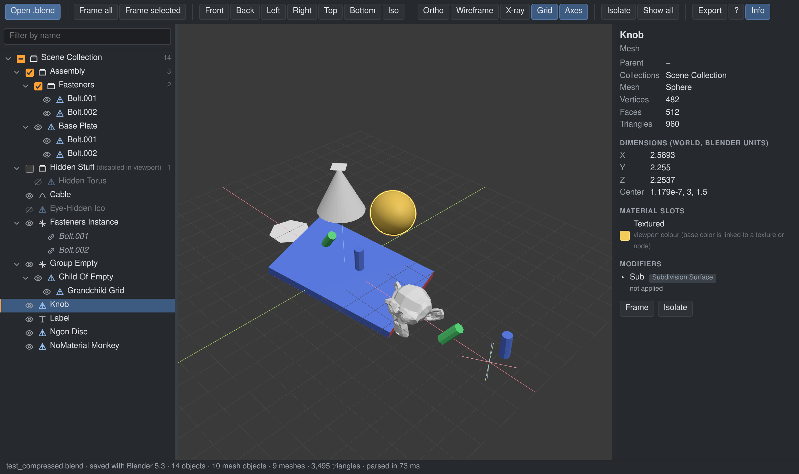

# Blend Viewer

Blend Viewer is one HTML file that opens Blender `.blend` files in a web browser. You do not need Blender. The viewer shows each object with its real name, the collection tree, and the material colors. Your file stays on your computer. The page uploads nothing and works offline from `file://`.



The screenshot shows `test_compressed.blend`, a small scene from the test files. The outliner is on the left and the 3D view is in the middle. The info panel on the right shows the selected object.

## Use the viewer

1. Open `dist/blend-viewer.html` in Firefox or Chromium. You can double-click the file.
2. Drop a `.blend` file on the page, or click the Open .blend button.
3. Click an object in the outliner or in the 3D view. The info panel shows the details of the object.
4. To save the objects for another program, click Export and select a GLB or STL option.

The outliner is the tree of collections and objects on the left. Click an eye icon to show or hide one object. Click a collection checkbox to show or hide all objects in that collection.

Mouse controls:

| Action | Result |
|---|---|
| Left drag | Orbit |
| Right drag, or Shift + left drag | Pan |
| Wheel | Zoom to the cursor |
| Click | Select (Ctrl+click adds or removes, Shift+click adds) |
| Double-click | Frame the object |

Keyboard shortcuts:

| Key | Action |
|---|---|
| Home | Frame all |
| F or Numpad . | Frame selected |
| Numpad 1, 3, 7 | Front, right, top view (with Ctrl: back, left, bottom) |
| Numpad 5 | Perspective or orthographic |
| Shift+Z, Alt+Z | Wireframe, X-ray |
| H, Shift+H, Alt+H | Hide selected, hide the others, show all |
| / | Isolate selected |
| Esc | Clear the selection |
| Ctrl+O | Open a file |

The viewer does not do these things:

- It does not apply modifiers or Geometry Nodes. Objects show their stored base mesh, and the info panel lists the modifiers that the viewer did not apply.
- It does not show textures or shader graphs. It uses one flat color for each material.
- It does not draw curves, text, surfaces, or metaballs. Blender makes this geometry only for display, so the file does not contain it. These objects appear in the outliner only.
- It does not play animation, armature poses, or shape keys. Each object shows in the position that the file stores.

## Build

You need Node.js 20 or later and npm. The tests ran on Node.js 22.

1. Install the dependencies:

   ```bash
   npm install
   ```

2. Build the page:

   ```bash
   npm run build
   ```

The build runs the TypeScript compiler to find type errors. Then it writes one file, `dist/blend-viewer.html`. All JavaScript, CSS, and the parser worker are inside that file.

To change the code with live reload, run `npm run dev` and open the URL that Vite shows.

## Test

The parser tests run in Node.js. They compare the parser output with the `ground_truth.json` file in each folder of `blend-viewer-handoff/test-files/`.

```bash
npm test
```

The browser tests open `dist/blend-viewer.html` from `file://` in headless Chromium and Firefox. A headless browser runs without a window. The tests load each test file. They examine object positions, colors, and initial visibility. They also examine selection, collection instances, and GLB and STL export.

1. Build the page:

   ```bash
   npm run build
   ```

2. Run the browser tests:

   ```bash
   npm run test:browser
   ```

The browser tests write screenshots and the exported files to `test-output/`.

The browser tests can also load a 200 MB file and measure stalls. A stall is a period in which the page cannot respond to input. If one stall is longer than 250 ms, the test fails. To add this test, add `--big`. This test needs `python3` with `numpy`. It makes the file in a temporary folder and deletes it after the run.

```bash
npm run test:browser -- --big
```

If Chromium uses software WebGL, uploads to the GPU stop the page for seconds. In that case the test shows the longest stall but does not fail.

To compare the parser with the Python reference parser on your own `.blend` files, set `BLEND_EXTRA_DIR` to their folder. This test needs `python3` with `numpy` and `zstandard`.

```bash
BLEND_EXTRA_DIR=/path/to/blend/files npm test
```

These environment variables change where the tests look:

| Variable | Meaning |
|---|---|
| `BLEND_TEST_FILES` | Folder with the test files (default: `test-files/` or `blend-viewer-handoff/test-files/`) |
| `CHROMIUM_BIN` | Path to Chromium, Chrome, or Brave (default: the first one found in `/usr/bin`) |
| `FIREFOX_BIN` | Path to Firefox (default: `/usr/bin/firefox`) |
| `BROWSERS` | `chromium`, `firefox`, or `chromium,firefox` (default) |
| `BIG_BLEND` | Path to an existing large `.blend` file for the stall test |
| `CHROMIUM_SOFTWARE` | Set to `1` to use software WebGL (SwiftShader) in Chromium instead of the GPU |

## Update the screenshot

The script `scripts/screenshot.mjs` opens the built page in Chromium, loads the test scene, selects the Knob object, and saves `docs/screenshot.png`. You must build the page first.

```bash
npm run screenshot
```

To use a different file, output path, or selected object, give them as arguments:

```bash
npm run screenshot -- my-scene.blend docs/screenshot.png "Object name"
```

## Project layout

| Path | Content |
|---|---|
| `src/io/` | zstd and gzip detection and decompression |
| `src/blend/` | File header, block headers, DNA parsing, pointer resolution, typed field access |
| `src/scene/` | Objects and world matrices, collections, meshes, materials, instances, render buffers |
| `src/worker.ts`, `src/parseClient.ts` | Parsing in a Web Worker, with a fallback to the main thread |
| `src/viewer/` | three.js scene, camera tools, picking, selection outline |
| `src/ui/` | Outliner, info panel, toolbar, note bar, stored preferences |
| `src/export/` | GLB and STL export |
| `test/` | Parser tests (Vitest) |
| `scripts/browser-test.mjs` | Browser tests (Puppeteer) |
| `scripts/screenshot.mjs` | Makes the README screenshot |
| `scripts/make-big-blend.py` | Makes a large test file from a small one |
| `scripts/ref_dump.py` | Runs the Python reference parser for the cross-check test |
| `docs/` | Images for this README |

The parser in `src/blend/` and `src/scene/` does not import three.js. For this reason, the tests can run the parser in Node.js.

## Design decisions

Blender 5.x files contain pointer addresses that are larger than 2^53. A JavaScript number cannot hold these addresses exactly, so two different addresses can become equal. The parser stores them as `BigInt` values.

A view layer is a set of collections that Blender shows together. A Base is the record that links an object to a view layer. If the Base of an object in the first view layer has bit `0x02` set, the object starts visible. If the file has view layers but the object has no Base, the object starts hidden. In that case the view layer excludes the collection of the object, and the info panel tells you. If the file has no view layers, all objects start visible.

Objects that are in the file but not in the active scene appear under "Not in this scene". They start hidden.

GLB export changes Z-up to Y-up in the same way as the glTF exporter of Blender. A shear is a slant that is not a rotation or a scale. A glTF node transform cannot contain shear. A child of a parent with a non-uniform scale can need shear, so the exporter puts that part into the vertices of the child. Each object keeps its exact world position and its place in the hierarchy.

The GLB file stores the exact Blender names. When three.js loads a file, it changes spaces to `_` and removes dots. For this reason, the three.js editor shows changed names. Blender and f3d show the names without changes.

The built page has a Content-Security-Policy that blocks all network requests. This makes sure that the page does not use the internet by accident.
